# 医药知识问答系统：项目架构、技术规则与 MVP 二阶段规划

> 基线日期：2026-09-26  
> 代码版本：当前工作区 `medical-knowledge-qa`  
> 规格依据：《医药知识问答系统_设计与开发规格_v1.md》  
> 本文描述当前代码真实行为；“二阶段规划”是尚未完成的后续设计。

## 1. 项目定位与当前结论

本项目是面向中文药品说明书的结构化、可追溯 RAG 系统。核心目标不是把 PDF 直接向量化，而是先恢复说明书结构、表格关系、药品身份和文档版本，再在元数据约束下完成混合检索、上下文恢复、证据压缩和受约束回答。

当前 MVP 已形成以下端到端闭环：

1. PDF 文本、章节、表格、图片解析及来源坐标保存。
2. MySQL 中的药品、商品、说明书版本和结构化内容持久化。
3. 结构优先的父子分块、主题聚合、摘要导航和稳定 ID。
4. MySQL BM25 + Qdrant Dense Vector 双路召回。
5. RRF 融合、本地 Cross-Encoder 精排、父块和相邻块扩展。
6. 口语问题的受控 LLM 查询改写。
7. 条件式上下文压缩和 token 预算控制。
8. `qwen3.5:latest` 基于原文证据生成回答，并校验引用、药品归属、数值和限制性结论。
9. CLI、FastAPI 页面、检索调试接口和三层评测框架。

当前更接近“可运行、可评测的本地 MVP”，尚未达到生产系统所需的数据规模、可观测性、异步导入、安全治理和完整评测覆盖。

## 2. 总体架构

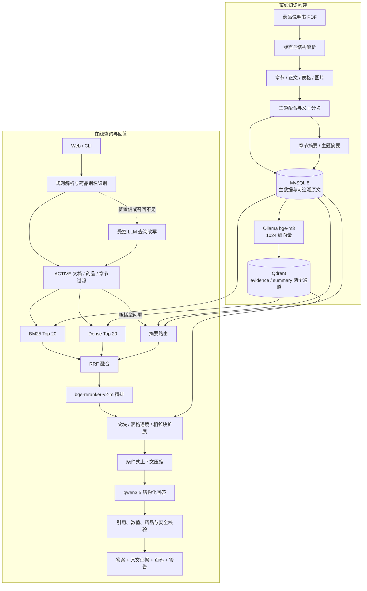

### 2.1 主要组件

| 层 | 当前实现 | 主要职责 |
|---|---|---|
| 解析层 | `app/parser` | 读取 PDF 文本层、识别章节、表格和图片，保留页码与 bbox。 |
| 分块层 | `app/chunker` | 结构识别、主题聚合、局部 Parent/Child、超长语义单元兜底、摘要导航。 |
| 关系存储 | MySQL 8 | 药品主数据、商品身份、版本、解析元素、表格、chunk 和索引状态。 |
| 向量索引 | Qdrant | 保存原始证据 child 和导航摘要的 Dense Vector。 |
| 模型服务 | Ollama | `bge-m3:latest` embedding；`qwen3.5:latest` 查询改写、压缩和回答。 |
| 精排 | sentence-transformers | 本地 `D:\model\bge-reranker-v2-m` Cross-Encoder。 |
| 在线检索 | `app/retrieval` | Query Understanding、过滤、BM25、向量召回、RRF、精排和上下文扩展。 |
| 回答生成 | `app/generator` | 证据打包、结构化输出、引用与医学风险校验、失败重试。 |
| 服务层 | FastAPI + 静态页面 | 问答、证据详情、健康检查和可选调试接口。 |
| 评测层 | `app/evaluation` | 解析、检索和回答三层评测及黄金集报告。 |

## 3. 离线文档处理

### 3.1 处理流程

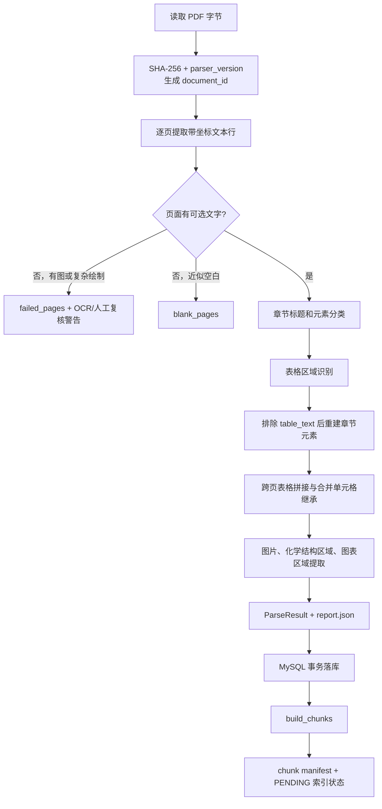

### 3.2 文本和章节识别规则

- 页面文本来自 PyMuPDF `page.get_text("dict", sort=True)`，保存文本、字体大小、粗体信息、阅读顺序和 bbox。
- 页顶 4.5% 区域默认识别为页眉，页底 4.5% 默认识别为页脚或页码。
- 列表项由数字序号、带圈数字、短横线或圆点前缀识别。
- 章节标题优先识别 `【章节名】` 等括号形式；无括号标题必须精确命中标准章节别名。
- 未进入任何已识别章节的内容归入“未分类”。这保证不丢原文，但可能降低章节过滤精度。
- 章节标题后的同一行正文会在分块阶段恢复为正文，不把尾随内容丢掉。
- 坐标统一使用 PDF point，左上角为原点，页码从 1 开始。

边界条件：

- 整份 PDF 没有可选择文本时直接失败，当前没有 OCR 自动回退。
- 有图像内容但无文字层的页面进入 `failed_pages`，文档会进入人工复核路径。
- 标题只支持已知章节别名和少量英文标题；版式异常或未知标题可能落入“未分类”。
- 当前阅读顺序主要依赖 PDF 自带 block 顺序，多栏复杂版式仍有错序风险。

### 3.3 表格处理规则

系统同时保存表格裁剪图、Markdown、原始 JSON、规范化 JSON、单元格和行级检索单元。

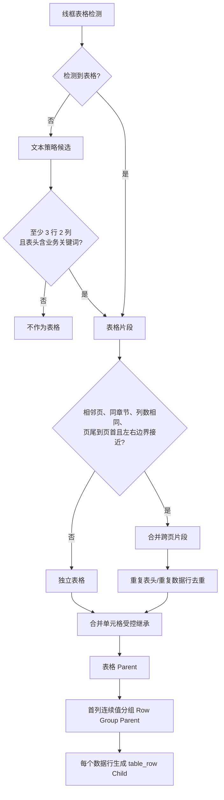

关键触发规则：

- 线框检测失败时才尝试文本表格策略。
- 文本表格必须至少 3 行、2 列，且首行出现“剂量、等级、频率、不良反应、项目、发生率”等关键词。
- 跨页合并要求：下一片段位于相邻页、同章节、列数相同；前页表格结束位置处于页面 70% 以下，后页表格开始位置处于页面 30% 以上；左右边界误差不超过 18 point。
- 合并单元格只对“事件、项目、系统器官、类别、症状、药品名”等语义关键列做 forward fill，并记录 `inherited_from_row`。
- 跨页无重复表头、重复数据行或自动拼接都会写入警告，要求人工核验。

边界条件：

- 无边框且首行缺少关键词的表格可能无法识别。
- 复杂嵌套表头、横向合并单元格和非规则二维布局没有完整语义恢复。
- 表格行来源当前通常对应单页行；跨页单行并没有专门重建逻辑。

### 3.4 图片处理规则

- 内嵌栅格图按尺寸粗分为 `glyph_fragment`、`chart` 或 `unclassified`。
- “化学结构式”到“分子式/分子量/性状”之间的矢量区域会裁剪为 `chemical_structure`。
- `图 N` 标题后的区域会保存为 `chart`。
- 只有存在 caption 的图片才生成可检索 image child；图片本身不做多模态 embedding。
- 化学结构图只作为可追溯资产保存，不解析 SMILES、InChI 或化学键。

## 4. 分块模块

### 4.1 分块层级

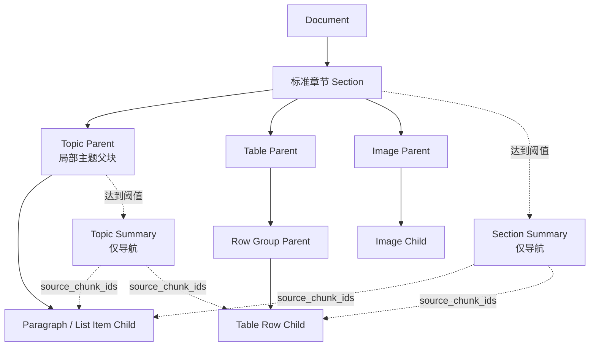

一个大章节下的多个片段不会全部合并成一个巨大父块。连续、同主题、同 section path 且未超过父块软上限的片段会组成一个局部 `topic_parent`；主题、子标题、路径变化或大小超限时开始新的小父块。因此，同一大章节可以产生多个局部父块。

### 4.2 `build_chunks` 的实际流程

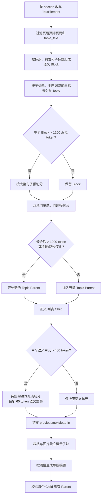

### 4.3 结构和主题规则

- 普通 PDF 行持续合并，直到出现句号、问号、叹号或分号等语义结束符。
- 列表项始终单独形成 block。
- 显式子标题、粗体短文本、编号标题、短冒号标题会建立新的 `section_path`。
- “处理原则：”这类前导内容可作为后续列表项的 `lead_in_id`。
- 主题来源依次是子标题、冒号前标签、医药主题词表和相邻上下文继承。
- 主题词覆盖腹泻、皮疹、肝肾功能异常、特殊人群、PPI、NSAIDs、剂量调整、停药和监测等常见说明书语义。
- “暂停用药、恢复用药、监测”等处理词在已有主题下不会轻易把当前主题改成动作名。

### 4.4 超长语义单元兜底

默认阈值：

| 参数 | 默认值 | 作用 |
|---|---:|---|
| `max_tokens` | 400 | 单个 Child 的目标上限。 |
| `overlap_tokens` | 60 | 相邻兜底片段允许重复上一完整句的上限条件。 |
| `parent_soft_max_tokens` | 1200 | Topic Parent 的软上限。 |

这里的 token 是确定性近似值：单个汉字、英文数字组合或非空白符各计一个单位，不等同于 Qwen 或 BGE 的真实 tokenizer。

兜底边界：

- 只在完整语义 block 超长时按完整句切分，不使用 `RecursiveCharacterTextSplitter` 作为主方案。
- 单句本身超过上限时保留整句并标记 `oversized_sentence`，避免切断否定词、条件或剂量单位。
- 重叠只复制完整句，并通过 `overlap_source_ids` 记录与上一片段的关系。
- Parent 的 1200 token 是软限制；“子标题 + 正文”会优先保留在一起，单个不可分句也可能超过阈值。

### 4.5 摘要索引规则

摘要是确定性导航文本，不是由 LLM 生成的医学结论，也不能直接作为最终引用。

| 摘要类型 | 触发条件 |
|---|---|
| Section Summary | 章节 child 总量 ≥ 2000 token，或 child 数 ≥ 8，或非默认主题数 ≥ 3。 |
| Topic Summary | 主题 child 总量 ≥ 800 token，且至少命中 2 个信息维度。 |

信息维度包括发生率、严重程度、发生时间、处理措施、剂量调整、特殊人群和相互作用。摘要记录 `source_chunk_ids` 与 `key_point_sources`，在线命中摘要后必须回到原始 paragraph/list/table_row。

### 4.6 可追溯数据模型

每个 chunk 至少保留：

- `document_id / section_id / parent_id / product_id / drug_id`
- 原始 `content` 和补全语境后的 `retrieval_text`
- `content_type / parent_type / topic_id / topic_name / section_path`
- `page_start / page_end / bbox / refs`
- `source_element_ids / lead_in_id / overlap_source_ids`
- `previous_chunk_id / next_chunk_id / split_reason`
- `content_hash / chunker_version / reading_order`

稳定 ID 由文档、类型、来源身份、chunker 版本和内容哈希组合生成。修改解析器或分块器版本时会产生新的可审计结果，不覆盖旧证据。

## 5. 数据库、版本和索引

### 5.1 核心实体关系

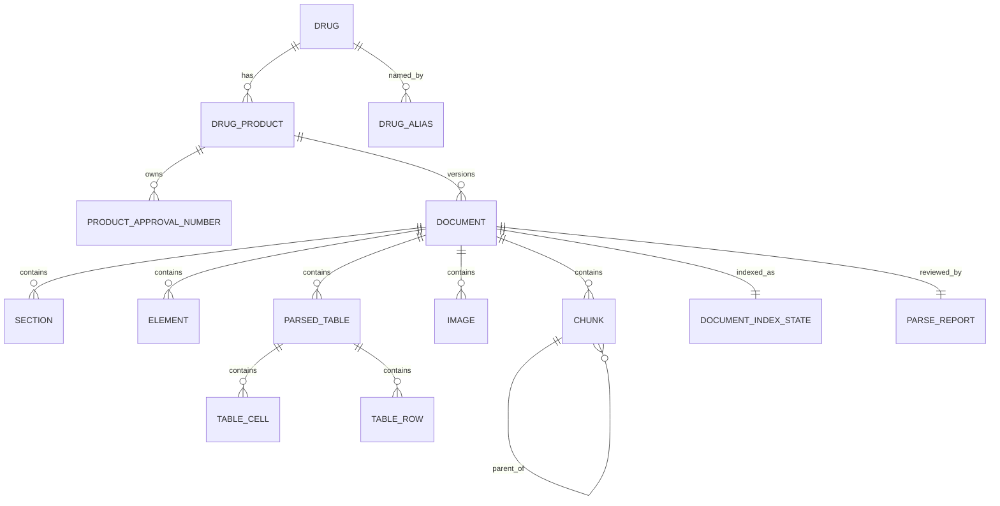

### 5.2 药品身份和文档版本

- 有批准文号时，商品身份优先由批准文号集合生成。
- 没有批准文号时，使用规范通用名和规范商品名作为后备身份。
- 通用名、商品名和英文名统一保存为 `drug_alias`，查询时从 ACTIVE 文档关联的别名中解析。
- 同一商品最多允许一份 `ACTIVE` 说明书，数据库唯一索引负责兜底。
- 更晚的可靠修订日期可以使旧版转为 `SUPERSEDED`；无法可靠判断的新版本进入 `PENDING`。
- 在线检索默认只读取 `ACTIVE` 文档，证据详情接口同样不会返回历史摘要或失效版本。

### 5.3 向量索引状态机

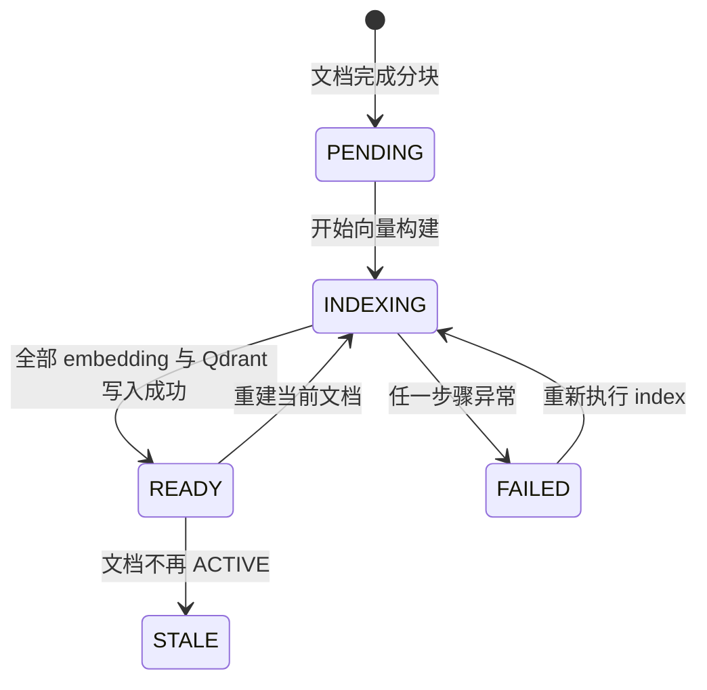

构建索引时先计算完整文档的全部 embedding，再删除和替换 Qdrant points，避免 Ollama 中途失败时提前移除最后一份可用向量索引。全量索引会清理非 ACTIVE 文档的 Qdrant points；定向索引不会删除其他文档。

Qdrant 使用 Cosine 距离，默认 collection 为 `medical_knowledge_chunks`。`index_channel=evidence` 保存原始 child，`index_channel=summary` 保存导航摘要。point ID 由 chunk ID 映射为稳定 UUID。

## 6. 在线查询与混合检索

### 6.1 Query Understanding

规则解析生成：

```json
{
  "drugs": [],
  "intent": "",
  "sections": [],
  "populations": [],
  "conditions": [],
  "entities": [],
  "comparison": false,
  "requires_exact_value": false
}
```

当前 intent 的实际作用：

- `overview`/`broad`：触发摘要路由，禁止直接 Top 3 快速生成，并影响父块扩展和回答组织。
- `comparison`：按药品和章节维度分别检索，禁止混成一次无约束 TopK。
- `exact_value`：减少相邻上下文扩展，并要求答案数值严格可由引用核对。
- 章节型 intent：主要通过 `sections` 转换为 MySQL 和 Qdrant 的硬过滤条件。
- `conditions/entities/populations`：参与压缩策略触发；其中 populations 当前不做硬过滤，避免短表格行或剂量段缺少人群标签造成漏召回。

规则边界：

- 药品别名必须唯一解析；同名映射到多个药品时直接报歧义。
- 支持省略常见剂型后缀，但只有省略后仍唯一时才有效。
- 比较问题必须至少识别两个药品，并出现“比较、区别、与、和、分别”等比较表达。
- `哪些/有哪些/主要/总体` 且没有精确数值要求时识别为概括型。
- 当前疾病、药物类别和复杂医学实体词典较小，规则未识别时依赖语义召回或查询改写。

### 6.2 查询改写触发与安全边界

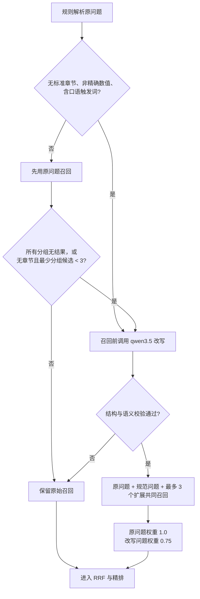

召回前的口语触发词包括“不能吃、能不能吃、怎么吃、一起吃、有啥、咋办、怎么办、会不会”等。召回后的兜底触发为：全部分组无证据，或未识别章节、不是精确值问题且最弱分组候选数小于 3。

LLM 改写必须通过以下校验：

- intent 必须属于允许枚举，章节必须映射到标准章节。
- 不得丢失原问题明确章节、比较意图、概括意图和精确值意图。
- 不得新增药品或数字；规范问题中的药品集合必须与原问题相同。
- 不得丢失否定词和精确实体。
- 概括型问题必须给出至少一个标准章节。
- 改写失败、Ollama 不可用或输出不合法时，自动保留原始检索链路。

### 6.3 双路召回、RRF 与精排


BM25 当前实现会读取过滤范围内全部原始 child，在应用层计算标准 BM25：

```text
score(d, q) = Σ IDF(t) × tf(t,d) × (k1 + 1)
              / (tf(t,d) + k1 × (1 - b + b × |d| / avgdl))

k1 = 1.2
b  = 0.75
IDF(t) = log(1 + (N - df(t) + 0.5) / (df(t) + 0.5))
```

中文查询同时产生单字和连续双字项；英文、数字、剂量和等级作为完整项。此方案强调当前小语料的精确可控性，但每次查询都扫描过滤后的 child，不适合大规模数据。

RRF 公式为：

```text
RRF(d) = Σ 1 / (60 + rank_i(d))
```

RRF 只融合名次。Cross-Encoder 才读取 `(query, candidate)` 完整语义，输入显式包含药品、章节、类型和内容。

概括型问题会额外查询最多 5 个摘要，摘要命中分数以 `0.25 / (60 + rank)` 加到其代表性原始 child 上。摘要本身不会进入最终回答证据。

### 6.4 多药问题

- 识别为 comparison 时，按每个药品和每个章节维度分别执行完整检索。
- 每个分组独立保留缺失状态；某个药没有证据时明确返回“当前说明书未检索到相关表述”。
- 未指定药品的普通问题如果命中多个药品，默认拒绝合并。
- 未指定药品但属于非精确、非比较的 `overview` 时，允许按各药品说明书分别归纳，并将整体置信度限制为 medium。

## 7. 上下文恢复与条件式压缩

### 7.1 上下文扩展

精排选出原始 child 后：

- `lead_in_id` 始终尝试恢复。
- 精确值和概括型问题不自动加入普通前后相邻 child。
- 普通事实问题可加入同文档、同章节、同 parent 的前后 child。
- 概括型命中或 table_row 命中会尝试加入 parent。
- 每条候选的扩展上下文预算默认 1200 近似 token。
- 同一个上下文 chunk 在同次结果中只发出一次，避免重复占用预算。

### 7.2 压缩策略决策

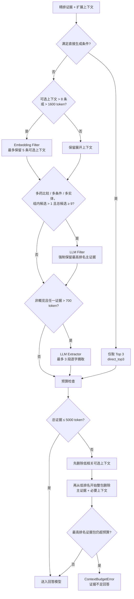

直接生成必须同时满足：

- 不是比较或概括问题。
- 药品、章节、人群、条件和精确实体均不超过一个。
- 问题不超过 32 近似 token。
- Top 3 能覆盖所有请求章节。
- Top 3 连同必要语境不超过 1000 token，且不超过总预算。

`budget_pruning` 的关键边界：主证据和它的必要表头/前导语构成不可拆的证据包。系统先删可选上下文，再整包删除低排名证据；不会只留下失去语义条件的表格行。最高排名证据包单独超过 5000 token 时拒绝继续生成。

## 8. 回答生成与校验

### 8.1 回答流程

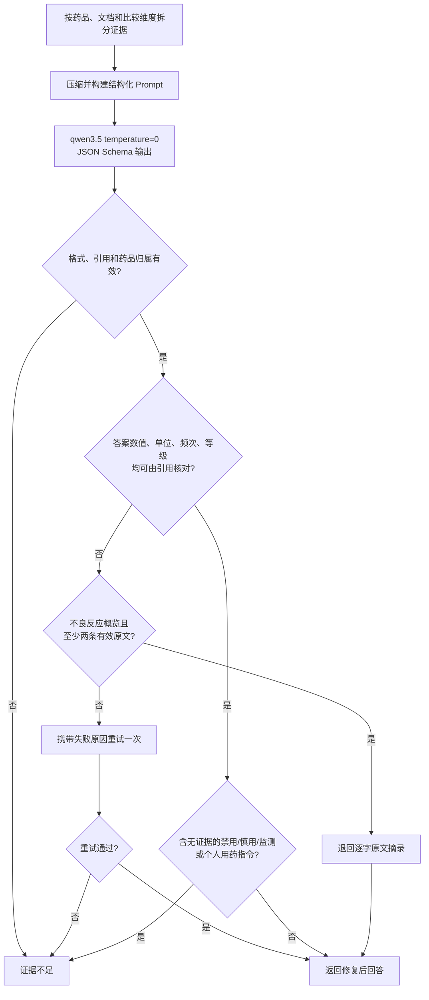

### 8.2 引用校验

- 模型只能引用给定 `chunk_id`。
- quote 必须是该 chunk 原文中的连续片段，最长 300 字符。
- 仅有空格或 PDF 换行差异时，可以从原文恢复连续片段；其他改写引用无效。
- 相同文档、页码和 quote 去重，优先保留 primary evidence。
- 单药分组中出现其他 `drug_id` 的引用会被剔除。
- 返回来源包含药品名、源文件、章节、页码、quote 和 chunk ID；跨页引用补充 `page_end`。

### 8.3 数值和安全边界

- 回答中的剂量、单位、百分比、等级、周期、频次和普通数字必须在有效引用中出现。
- “3级”可以由“3或4级”支持，但不能由无关等级推导。
- 列表编号不作为医学数值校验。
- “禁用、不推荐、慎用、需要监测”等强限制性结论必须逐字出现在引用中。
- 出现“你/您应该服用、停药、加量、减量”等个人处方指令时直接拦截。
- 模型主动拒答时统一转换为证据不足回答，不保留无关引用。
- 多份说明书按文档分别回答并显示修订日期，不自行裁决冲突。

## 9. API、页面和运行配置

当前接口：

| 接口 | 状态 | 说明 |
|---|---|---|
| `GET /` | 已实现 | 返回本地静态问答页面。 |
| `GET /api/v1/health` | 已实现 | 仅返回进程级 `ok`，不检查依赖。 |
| `POST /api/v1/chat/query` | 已实现 | 问答，可选药品过滤和 debug 输出。 |
| `POST /api/v1/retrieval/debug` | 已实现 | 仅 `ENABLE_RETRIEVAL_DEBUG=1` 时开放。 |
| `GET /api/v1/evidence/{chunk_id}` | 已实现 | 查看 ACTIVE 文档中的原始证据和来源。 |
| `POST /api/v1/documents/ingest` | 未实现 | 规格草案中的上传导入接口。 |
| `GET /api/v1/documents/{id}/status` | 未实现 | 规格草案中的导入状态接口。 |

主要运行依赖：

- MySQL 8：结构化事实和来源主库。
- Qdrant：Dense Vector 检索。
- Ollama：`bge-m3:latest` 和 `qwen3.5:latest`。
- sentence-transformers：本地 Cross-Encoder。
- FastAPI/Uvicorn：HTTP 服务和静态页面。

运行边界：

- 服务第一次请求时惰性构建模型和依赖；首次请求延迟可能明显高于后续请求。
- FastAPI 使用同步处理，模型调用耗时期间会占用工作线程。
- `/health` 不能反映 MySQL、Qdrant、Ollama 或 reranker 是否可用。
- API 当前只允许 `document_versions=["current"]`。
- 没有登录、角色、限流、审计日志和公网部署安全配置。

## 10. 评测现状

当前黄金集包括 5 份 ACTIVE 说明书、21 道单药检索题、1 道跨药比较题和 7 道回答题，其中 2 道应拒答。

已报告结果：

| 指标 | 当前报告 |
|---|---:|
| 单药精排 Recall@5 | 1.0000 |
| 单药精排 MRR | 0.9762 |
| 表格行命中@5 | 1.0000 |
| 跨药比较 Recall@5 | 1.0000 |
| 跨药引用污染率 | 0 |
| 回答引用可回溯率 | 1.0000 |
| 无答案问题拒答率 | 1.0000 |

这些结果只能说明当前小样本可复现，不能外推到所有说明书。规格第 17.4 节要求每种药至少准备 10 个精确问题、5 个特殊人群问题、5 个剂量问题、5 个不良反应/注意事项问题、3 个相互作用问题，以及表格、口语、易混药和无答案样例；当前覆盖仍明显不足。

自动评测能够检查来源、药品归属、字符串、排序和拒答状态，但无法独立证明引用完整支撑每个医学结论。Faithfulness、答案相关性和引用支持度仍保留人工审核字段。

## 11. 当前 MVP 的主要边界

| 边界 | 当前表现 | 风险 |
|---|---|---|
| OCR | 无自动 OCR。 | 扫描版或缺失文字层页面无法进入知识库。 |
| 复杂版面 | 依赖 PDF block 阅读顺序和规则标题。 | 多栏、浮动框、异常标题可能错序或未分类。 |
| 医药元数据 | `diseases`、`drug_classes` 仍为空，主题和人群词典有限。 | 复杂条件过滤和药物类别查询依赖语义召回。 |
| BM25 规模 | 每次加载过滤范围内全部 child 后计算。 | 文档量增长后查询延迟和数据库压力线性上升。 |
| 摘要 | 当前是规则生成的导航摘要。 | 对真正跨章节的高层概括覆盖有限。 |
| 图片 | 仅保存资产和有标题图片的文字检索。 | 曲线、图中数字和化学结构不能被语义查询。 |
| 版本审计 | 数据层保留历史，但 API 只查询 current。 | 无法通过接口比较历史版本或查看变更。 |
| 多来源冲突 | 按文档分别陈述，不自动检测冲突字段。 | 用户仍需人工理解差异来源。 |
| 服务可靠性 | 同步请求，依赖本机三个服务。 | 高并发、冷启动和长回答容易超时。 |
| 可观测性 | 只有基础异常日志和 debug 输出。 | 难以持续定位召回、压缩、模型和延迟问题。 |
| 安全治理 | 无认证、权限和限流。 | 不适合直接暴露到公网。 |
| 评测覆盖 | 黄金集规模小、药品少。 | 指标容易过拟合当前五份文档。 |

## 12. MVP 后二阶段实现规划

二阶段应遵循原规格第 21 章的原则：由评测失败类型触发复杂度，不直接引入 GraphRAG、Agent 或 HyDE。建议拆成 2A“质量闭环”和 2B“规模与工程化”，最后保留按指标触发的 2C 能力。

### 12.1 二阶段架构

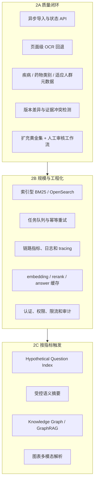

### 12.2 2A：质量闭环，建议优先完成

#### 2A-1. 文档导入 API 与任务状态

对应原规格第 15.1、15.2 节。新增：

- `POST /api/v1/documents/ingest`：上传 PDF，返回 `task_id`、`file_hash` 和初始状态。
- `GET /api/v1/documents/{document_id}/status`：返回解析、人工复核、分块和向量索引状态。
- 新增 `ingest_job` 表，建议字段：`id`、`file_hash`、`parser_version`、`status`、`stage`、`progress`、`error_code`、`error_detail`、`document_id`、`created_at`、`updated_at`。
- 状态建议：`QUEUED → PARSING → REVIEW_REQUIRED/CHUNKING → INDEXING → READY`，异常进入 `FAILED`，允许从可恢复阶段重试。
- 同一 `file_hash + parser_version` 的并发请求复用现有任务，避免重复解析。

验收：重复上传幂等；进程中断后可恢复；失败页和表格警告可通过 API 查看；只有解析和索引均完成的文档进入在线查询。

#### 2A-2. 页面级 OCR 回退

对应原规格第 5、16、20 章中“失败不静默”和扫描页风险。

- 只对“无可选择文本但存在图像/复杂绘制”的页面触发 OCR，不对正常页面重复 OCR。
- 保存 OCR 引擎、版本、置信度、渲染 DPI 和原始页面 bbox 映射。
- OCR 文本作为新的 element 类型，例如 `ocr_paragraph`，不得覆盖原始文本层。
- OCR 低置信度页面继续标记 `REVIEW`，不得因 OCR 有输出就自动视为可靠。
- 增加数值、单位、特殊符号和中英文混排专项评测。

验收：扫描页可生成可追溯元素；每条 OCR 证据能回到页面区域；低置信结果不会进入无警告 READY。

#### 2A-3. 医药元数据增强

当前 chunk 的 `diseases` 和 `drug_classes` 为空。建议建立规则优先的数据抽取层：

- 药物类别：PPI、NSAIDs、保钾利尿药、CYP 抑制剂/诱导剂等。
- 疾病和条件：高血压、肝肾功能异常、腹泻、皮疹等。
- 风险动作：禁用、不推荐、慎用、监测、减量、暂停、恢复、永久停药。
- 数值实体：剂量、单位、频次、疗程、等级、阈值和比较符。
- 每个规范值保留原值、抽取方法、置信度和 source element ID。

这些元数据先作为排序特征和调试字段；只有标注覆盖率和召回评测证明安全后，才升级为硬过滤条件。

#### 2A-4. 版本差异与冲突处理

当前系统保存版本关系，但在线只查询 ACTIVE 文档。二阶段建议增加：

- 文档级 diff：按标准章节、topic 和表格主键对齐新旧版本。
- `document_change` 表记录新增、删除、修改的 source chunk 及原文哈希。
- 多商品或多来源对同一药品给出不同数值时，生成 `conflict_group_id`，回答按来源和修订日期并列展示。
- 增加历史版本查询参数，但默认仍为 current。
- 不由 LLM 裁决哪个版本“更正确”；只陈述版本、来源和差异。

#### 2A-5. 评测集扩充与回归门禁

按原规格第 17.4 节扩充到每药最低数量，并新增：

- 口语改写、否定、相近药名、药物类别和多条件问题。
- 表格跨页、合并格、异常表头和扫描页案例。
- 未指定药品的概览题、跨药汇总题和不应合并题。
- 数值、单位、范围、等级、频次和限制性结论专项集。
- 查询改写前后 Recall 差异、错误扩展率和新药品/新数字引入率。
- 压缩前后 Recall、关键条件保留率和 token 节省率。

建议 CI 门禁：解析来源保留率 100%；跨药污染率 0；引用可回溯率 100%；数值/单位错误率 0；其他排序指标不得相对基线显著回退。

### 12.3 2B：规模与工程化

#### 2B-1. 索引型词法检索

当 BM25 扫描的过滤后 chunk 数量或 P95 延迟超过阈值时，将应用层 BM25 迁移到专用倒排索引。可选路径：

1. 中小规模先评估 MySQL ngram FULLTEXT 的真实排序质量与可配置同义词方案。
2. 数据量和并发继续增长时迁移 Elasticsearch/OpenSearch。
3. 保留当前 Python BM25 作为离线评测基线，确保迁移前后 Recall、MRR 和数值词召回可比较。

迁移时必须保留 `bm25_rank`、原始 score、过滤条件和索引版本，不能让调试链路变成黑盒。

#### 2B-2. 任务队列、并发与缓存

- 解析、OCR、embedding 和索引构建移入任务队列。
- 每个阶段使用幂等键和 manifest hash，支持重试且不产生重复 point。
- 缓存文档 embedding；模型或 retrieval_text 未变化时不重复计算。
- 可选缓存规范化 query 和 rerank 结果，key 必须包含文档版本集合、模型版本和配置版本。
- FastAPI 在线问答使用受控并发、请求超时和取消传播，避免浏览器断开后模型继续长时间运行。

#### 2B-3. 可观测性

对应原规格第 16 章，至少记录：

- 解析耗时、失败页、章节/表格/图片/chunk 数量。
- Query Understanding 结果和查询改写触发原因。
- Metadata 过滤前后数量、BM25/Vector/RRF/Reranker 各阶段耗时和候选数。
- Parent expansion 与压缩前后 token、策略、删除原因。
- LLM 模型、输入输出 token、重试、拒答和总耗时。
- 无证据率、引用剔除率、数值校验失败率、跨药污染和用户反馈。

建议为每次请求生成 `trace_id`，贯穿 API、检索、压缩、生成与证据详情。

#### 2B-4. 安全和运维

- 用户和管理员身份认证；debug、导入和历史版本接口按角色授权。
- 限流、上传大小/类型校验、恶意 PDF 隔离和临时文件清理。
- 密钥使用环境变量或密钥服务，日志不得输出连接密码、API Key 或完整个人输入。
- MySQL、Qdrant 和对象文件的备份恢复流程。
- `/health/live` 与 `/health/ready` 分离；ready 检查 MySQL、Qdrant、Ollama 和 reranker。
- 为模型、prompt、解析器、分块器和索引记录明确版本，支持一次回答的完整审计。

### 12.4 2C：只在指标触发时增加

| 触发现象 | 建议能力 | 启用前验证 |
|---|---|---|
| 口语 query 的 Recall@K 在查询改写后仍低 | Hypothetical Question Index | 与现有 rewrite 做消融实验，确认收益不是来自扩大噪声。 |
| 概括型和跨章节问题持续漏召回 | 受控 LLM Section Summary | 摘要必须绑定 source chunk，最终引用仍回原文；评测摘要幻觉率。 |
| 多条件候选仍噪声高 | 强化 LLM Filter | 评测关键证据误删率，并保留最高排名证据兜底。 |
| Parent 长度经常超过预算 | 结构化 Extractor 或句级索引 | 验证否定、条件、单位和表头没有被摘取丢失。 |
| 多跳药物关系成为核心需求 | Knowledge Graph / GraphRAG | 先明确实体关系 schema 和事实来源，不能从回答文本反向造图。 |
| 图表中的数值成为核心问答来源 | 多模态图表解析 | 保存图中元素坐标和原图证据，不能仅保存视觉模型描述。 |

HyDE、GraphRAG、Agent、化学结构相似检索和互联网医学搜索仍不应作为默认二阶段任务。只有明确业务问题、黄金集和消融结果证明现有链路无法满足时再引入。

## 13. 建议实施顺序

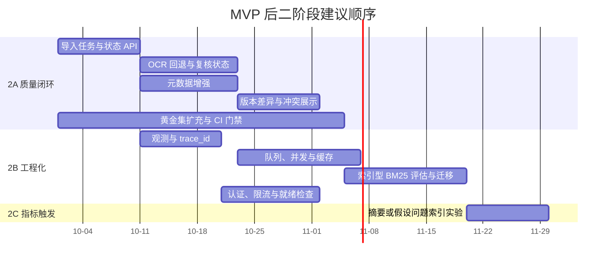

日期只用于表达依赖关系，不是既定排期。优先级应是：先扩大评测和补齐可观测性，再根据真实失败样例决定检索复杂度。

## 14. 代码导航

| 主题 | 入口文件 |
|---|---|
| PDF 总流程 | [`app/parser/pdf.py`](../app/parser/pdf.py) |
| 章节与版面 | [`app/parser/layout.py`](../app/parser/layout.py) |
| 表格 | [`app/parser/tables.py`](../app/parser/tables.py) |
| 图片 | [`app/parser/images.py`](../app/parser/images.py) |
| 父子分块 | [`app/chunker/parent_child.py`](../app/chunker/parent_child.py) |
| 摘要索引 | [`app/chunker/summaries.py`](../app/chunker/summaries.py) |
| 数据模型 | [`app/models.py`](../app/models.py) |
| MySQL 落库与版本 | [`app/storage/mysql.py`](../app/storage/mysql.py) |
| BM25 与检索读取 | [`app/storage/retrieval.py`](../app/storage/retrieval.py) |
| Qdrant | [`app/storage/vector_store.py`](../app/storage/vector_store.py) |
| 索引流水线 | [`app/indexer/pipeline.py`](../app/indexer/pipeline.py) |
| Query Understanding | [`app/retrieval/query.py`](../app/retrieval/query.py) |
| 查询改写 | [`app/retrieval/rewrite.py`](../app/retrieval/rewrite.py) |
| 混合检索 | [`app/retrieval/pipeline.py`](../app/retrieval/pipeline.py) |
| 上下文压缩 | [`app/retrieval/compression.py`](../app/retrieval/compression.py) |
| 回答与校验 | [`app/generator/answer.py`](../app/generator/answer.py) |
| FastAPI | [`app/web/api.py`](../app/web/api.py) |
| 评测 | [`app/evaluation/runner.py`](../app/evaluation/runner.py) |

## 15. 总结

当前系统的主链路已经符合原规格的核心设计：

```text
PDF
→ 可追溯结构化知识
→ 结构优先分块与摘要导航
→ Metadata 约束下的 BM25 + Dense 召回
→ RRF + Cross-Encoder
→ 父级语境恢复与条件式压缩
→ 基于原始证据的受约束回答
```

下一阶段最关键的工作不是继续堆叠 RAG 技术，而是补齐 OCR、异步导入、医学元数据、版本冲突、可观测性和足量评测。完成这些质量和工程基础后，再由 Recall、噪声、延迟和业务场景决定是否引入新的索引或图谱能力。
